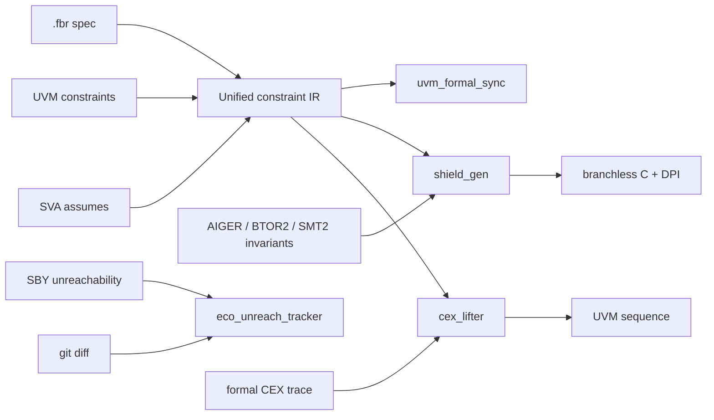

# Unified Formal-to-UVM Constraint Bridge & Sub-Microsecond Runtime Legality Shield

A compiled bridge between formal verification and UVM simulation. One shared constraint IR (SystemVerilog width/sign
semantics, evaluated identically by a Python interpreter, a Z3 encoder, a BDD bit-blaster and a C code generator)
feeds four tools:

| Tool | Inputs | Outputs |
|---|---|---|
| `uvm_formal_sync` | `uvm_sequence_item` constraints, SVA `assume` files, bus-view mapping, optional `.fbr` single-source spec | `audit.json` / `audit.md` drift report, `unified_ast.json`; `gen` compiles a `.fbr` spec into both a UVM item and SVA assumes |
| `shield_gen` | Protocol FSM spec (YAML), legality rules, SVA assumes, AIGER / BTOR2 / SMT-LIB2 invariants | `sv_legality_shield.c/.h`, DPI-C package with pure-SV fallback, `pre_randomize()` shield item, `shield_report.json` |
| `eco_unreach_tracker` | Formal unreachability certificates (SymbiYosys cover logs), RTL, git diff | `unreachable_bins.json` live mask, SV include with `ignore_bins` macros, re-prove list |
| `cex_lifter` | Counterexample VCD/FST, bus monitor definition, RTL, failing property, UVM item | Minimal parameterized UVM sequence (`*_seq.sv`) and lift report |



## Install

```bash
python -m pip install -e ".[dev]"
```

`ziglang` provides a portable C compiler for building and benchmarking shields; set `FBRIDGE_CC` to use another compiler.

## uvm_formal_sync

```bash
uvm_formal_sync check --uvm examples/axi_lite_csr/tb/axil_item.sv \
  --sva examples/axi_lite_csr/formal/axil_env_assumes.sv \
  --map examples/axi_lite_csr/formal/mapping.yaml \
  --spec examples/axi_lite_csr/spec/axil.fbr --out build/sync

uvm_formal_sync gen --spec examples/axi_lite_csr/spec/axil.fbr \
  --map examples/axi_lite_csr/formal/mapping.yaml --out build/gen
```

Each bus view (`mapping.yaml`) projects temporal, signal-level assumes onto transaction fields at the sampling cycle
(bounded unrolling with existential quantification of unmapped signals). Two exists-forall queries per view find:

- `SIM_ALLOWS_FORMAL_FORBIDS`: stimulus UVM can generate that formal assumed impossible (vacuous proofs or illegal stimulus);
- `FORMAL_ALLOWS_SIM_FORBIDS`: behaviour formal explored that simulation never generates (coverage gap or spurious CEX).

Findings carry an isolated witness, joint culprits when several assumes only fail together, and a suggested
constraint or assume. Unsat cores report conflicting UVM constraints and vacuous formal environments; redundant
constraints and dead soft constraints are listed as info.

## shield_gen

```bash
shield_gen compile examples/mesi_coherence/shield.yaml --out build/shield --build
shield_gen query examples/mesi_coherence/shield.yaml --state line=S,pend=NONE,credits=3,excl=0 --action op=CleanUnique,size=6
shield_gen bench examples/mesi_coherence/shield.yaml
```

Reachability is computed symbolically (interleaved current/next BDD variables) and pruned by imported formal
invariants. Legal (state, action) pairs form one ROBDD ordered state-bits-first; distinct sub-graphs at the
state/action boundary become action classes. The generated C API:

```c
int        is_action_legal(shield_u64 state_hash, shield_u64 candidate_tx);
int        project_or_mask_action(shield_u64 state_hash, shield_u64 candidate_tx,
                                  shield_u64 *repaired_tx, shield_u64 *field_masks);
shield_u64 <name>_explain(shield_u64 state_hash, shield_u64 candidate_tx);
shield_u64 <name>_step_action(shield_u64 state_hash, shield_u64 tx);
shield_u64 <name>_step_env(shield_u64 state_hash, int env_id);
```

Small specs compile to O(1) class tables plus legality bitmaps; larger ones to a fixed-depth walk over packed
64-bit BDD nodes with absorbing terminals, so evaluation has no data-dependent branches. Repair follows the
candidate's bits and flips only where the path would reach FALSE, so the result is always legal and preserves
higher-priority fields. Per-field marginal masks and intervals feed `inside` constraints in the generated shield item,
so `randomize()` never aborts; `post_randomize()` repairs any cross-field violation.

`examples/mesi_coherence/fuzz_demo.py` drives a random agent with and without the shield and also reports
model mismatches: states reached by the abstract tracker that the formal invariants prove unreachable.

## eco_unreach_tracker

```bash
EX=examples/axi_lite_csr
eco_unreach_tracker import-sby --rtl $EX/rtl/axil_csr.sv $EX/formal/axil_csr_cover.sv \
  --log $EX/formal/sby_cover.log --out build/eco/unreach_index.json
eco_unreach_tracker update --rtl $EX/rtl/axil_csr.sv $EX/formal/axil_csr_cover.sv --index build/eco/unreach_index.json \
  --git-base HEAD --out build/eco/unreachable_bins.json --svh build/eco/unreachable_bins.svh
```

Fan-in cones are extracted with pyslang, following continuous assigns, procedural blocks (with if/case control
context), functions, instance ports and `bind`. Each certificate stores a fingerprint of the normalized driver text in
its cone, so formatting-only edits keep facts alive while any logic change inside a cone invalidates exactly the
affected facts; diff hunks are mapped back to the touched signals for the report.

## cex_lifter

```bash
cex_lifter --vcd examples/axi_lite_csr/formal/cex_dma_len.vcd --monitor axi4_lite \
  --rtl examples/axi_lite_csr/rtl/axil_csr.sv --top axil_csr \
  --assert-file examples/axi_lite_csr/rtl/axil_csr.sv --assert-label ap_dma_len_bound --define FORMAL \
  --uvm examples/axi_lite_csr/tb/axil_item.sv --name cex_dma_len --out build/cex
```

Bus beats are assembled into transactions from the monitor definition (built-in `axi4_lite` and `axi4` profiles).
The lifter locates the failing cycle, then dynamically slices backwards through RTL drivers, evaluating their
guarding conditions on the trace. Transactions with no influence (or only handshake-timing influence) are dropped,
only influencing bits are pinned (e.g. `data[11:0] == 12'h900`), and the remaining fields stay random under the
item's constraints. Z3 checks every lifted item against the UVM constraints and turns blocking constraints
(unsat cores) into `constraint_mode(0)` calls with a warning.

## Development

```bash
python -m pytest
python bench/run_benchmarks.py
python examples/mesi_coherence/fuzz_demo.py
```
